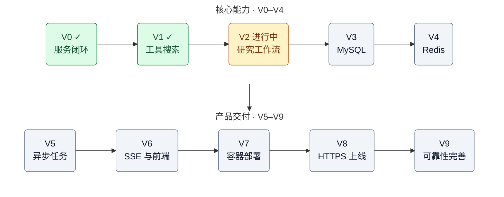

# AI Research Platform

使用 Go + Gin 和 Python + OpenAI Agents SDK 构建的研究助手项目。

## 开发路线图：V0 → V9

进度更新日期：2026-10-12。路线沿用项目最初的 V0～V9 规划，V9 是本项目第一轮完整交付的终点。
状态依据当前代码和已经确认的运行结果；没有运行验证的功能不视为验收完成。

- **已完成**：阶段功能已实现，并已确认主要流程可运行。
- **进行中**：部分功能已实现，仍有开发或验收工作。
- **待开发**：计划目标，当前尚未实现。
- 下方任务清单的 `[x]` 表示该项已实现或已完成；阶段是否结束还要看验收标准。



完整目标与验收方式见文末的[阶段目标与验收](#阶段目标与验收)。
图中的前后关系表示主线学习顺序：基础校验、超时和错误处理从 V0 开始，后续每一阶段继续完善。

## 请求流程

```text
客户端
  → Go Gin（8080）
  → Python FastAPI（8000）
  → Agent / 模型 → 按需调用本地笔记搜索或联网搜索工具
  → 返回回答
```

## 项目结构

```text
ai-research-platform/
├── backend/
│   ├── main.go
│   ├── go.mod
│   └── go.sum
├── agent-service/
│   ├── .env                  # 本地配置，不提交到 Git
│   ├── main.py
│   ├── research/
│   │   ├── __init__.py
│   │   ├── research_agent.py
│   │   ├── schemas.py        # 结构化搜索计划
│   │   ├── planner.py        # 研究规划 Agent
│   │   ├── plan_demo.py      # Planner 独立验证入口
│   │   ├── tools.py          # 本地笔记搜索
│   │   └── web_search.py     # Tavily 联网搜索
│   ├── pyproject.toml
│   └── uv.lock
├── .gitignore
└── README.md
```

## 开发环境

- Go：版本要求见 backend/go.mod。
- Python：版本要求见 agent-service/pyproject.toml。
- uv：用于安装 Python 依赖和运行服务。
- 可用的模型服务配置。

## 配置模型与搜索服务

在 [Tavily 控制台](https://app.tavily.com) 获取搜索 API Key。它与模型服务的 API Key 分别配置。

在 `agent-service/.env` 中填写以下配置，将占位文字替换为已验证可用的值：

```dotenv
OPENAI_API_KEY="你的模型服务 API Key"
OPENAI_BASE_URL="你已验证可用的完整模型服务 Base URL"
TAVILY_API_KEY="你的 Tavily API Key"
```

`research/__init__.py` 会通过 `python-dotenv` 加载该文件。启动服务或导入
`research.web_search` 等模块时都会触发加载，无需每次新开终端后重新 `export`。
配置文件路径根据代码文件的位置确定，不依赖终端当前目录。

已有环境变量优先于 `.env` 中的值（`override=False`）。如果旧终端的配置需要改为使用
`.env`，先执行 `unset OPENAI_API_KEY OPENAI_BASE_URL TAVILY_API_KEY`，再启动服务。
修改 `.env` 后需重新启动 Python 服务。

`.env` 已被根目录 `.gitignore` 忽略，不要将真实密钥写入代码、README 或提交到 Git。
缺少 `TAVILY_API_KEY` 时，联网搜索会失败；本地笔记搜索不需要这个 Key。

安装依赖后，在 `agent-service` 目录执行以下命令检查配置是否存在，输出不会显示密钥：

```bash
uv run python -c 'import research; import os; print({name: bool(os.getenv(name)) for name in ["OPENAI_API_KEY", "OPENAI_BASE_URL", "TAVILY_API_KEY"]})'
```

该检查只确认变量非空，不验证密钥或服务地址是否有效。

## 启动 Python 服务

在项目根目录打开终端：

```bash
cd agent-service
uv sync --locked
uv run uvicorn main:app --reload --host 127.0.0.1 --port 8000
```

健康检查：http://127.0.0.1:8000/health

接口文档：http://127.0.0.1:8000/docs

## 启动 Go 服务

在项目根目录另开一个终端：

```bash
cd backend
go mod download
go run .
```

健康检查：http://127.0.0.1:8080/ping

修改 Go 代码后，需要重新启动 Go 服务。

## 发起研究请求

```bash
curl -i --max-time 140 \
  -X POST http://127.0.0.1:8080/api/research \
  -H 'Content-Type: application/json' \
  -d '{"query":"请解释 Redis 缓存穿透，并举一个例子。"}'
```

成功响应示例：

```json
{
  "result": "模型生成的回答"
}
```

## 测试联网搜索

启动两个服务后，通过 Go 接口提交明确要求联网的问题：

```bash
curl -i --max-time 140 \
  -X POST http://127.0.0.1:8080/api/research \
  -H 'Content-Type: application/json' \
  -d '{"query":"请联网查找 Go 官方文档，解释 context 如何取消 HTTP 请求，并提供来源链接。"}'
```

检查 Python 终端是否出现 `search_web` 的执行日志和 `[source]` 链接，再核对回答中
的来源是否来自实际搜索结果。仅看到回答或 HTTP 200，不能证明发生了联网搜索。

也可以在 `agent-service` 目录单独测试搜索 API，跳过 Go 和模型调用：

```bash
uv run python -c 'import asyncio, json; from research.web_search import fetch_web_results; result = asyncio.run(fetch_web_results("site:go.dev context cancellation")); print(json.dumps(result, ensure_ascii=False, indent=2))'
```

## 联网搜索的当前限制

- 当前使用 Tavily 的 `basic` 搜索，只读取返回的内容片段，不主动打开来源网页或抓取全文。
- 每条片段还会截取前 1500 个字符，因此可能缺少完整上下文；有来源链接不代表已阅读或核验全文。
- Agent 根据片段生成回答，引用准确性仍需核对；当前没有自动验证结论与来源是否一致。
- 搜索结果可能为空，也不保证覆盖所有相关资料或最新信息。
- 单次搜索操作设置了 25 秒期限，仍受整个 Agent 执行的 120 秒超时限制。
- 搜索工具异常会向外抛出，当前由 Python 接口返回 500，再由 Go 转为 502；具体原因查看 Python 日志。

## Go 接口状态码

| 状态码 | 含义                                       |
| ------ | ------------------------------------------ |
| 200    | 成功返回答案                               |
| 400    | 请求格式错误或问题不符合要求               |
| 500    | Go 内部构造请求失败                        |
| 502    | Agent 服务连接失败、执行失败或返回无效结果 |
| 504    | Agent 执行或通信超时                       |

问题去除首尾空白后，长度应为 1～5000 个字符。

Python Agent 执行超时为 120 秒，Go HTTP 客户端超时为 130 秒。

## 阶段目标与验收

以下是后续开发计划，不代表功能已经存在。每完成一项更新任务清单，每通过一个阶段的验收再更新路线图状态。

### V0：最小服务闭环 · 已完成

**目标：** 用户提交问题，Go 调用 Python，Python 调用模型，最终返回答案。

- [x] 初始化独立项目、Go 模块和 Python 依赖环境。
- [x] Gin 提供 `GET /ping` 和 `POST /api/research`。
- [x] FastAPI 提供 `GET /health` 和 `POST /research`。
- [x] 使用 `Agent + Runner` 执行模型调用，返回 `{"result": "..."}`。
- [x] 校验输入，处理服务不可用、无效响应与请求超时。
- [x] 添加 README、Git 忽略规则，提交代码并推送到 GitHub。

**验收：** 从 Go 的 8080 端口提交问题可得到真实回答；空白问题返回 400；停止 Python 后 Go 返回 502 且自身保持运行。

**学习重点：** HTTP 服务与客户端、JSON 编解码、异步函数、环境变量、Git 基础。

### V1：工具调用与联网搜索 · 已完成

**目标：** Agent 能获取外部信息，使用实际返回的资料组织回答。

- [x] 用 `function_tool` 封装 `search_notes`，搜索本地项目笔记。
- [x] 接入 Tavily，提供 `search_web` 和可独立调用的 `fetch_web_results`。
- [x] 返回标题、URL 和内容片段；每次最多 3 条，每条最多 1500 个字符。
- [x] 在提示词中区分本地笔记搜索、联网搜索及引用规则。
- [x] 打印工具执行与来源日志，处理搜索超时、认证失败和网络异常。
- [x] 自动加载 `agent-service/.env`，配置模型与搜索服务的 Key。
- [x] 记录搜索片段的限制，提供单独搜索与完整接口测试命令。

**验收：** 本地笔记问题可引用笔记编号；联网问题触发真实搜索并返回来源链接；能从日志核对工具执行和来源。
本阶段不包含网页全文读取，也不代表已经自动验证引用与结论的一致性。

**学习重点：** 函数工具、模型与工具之间的数据传递、第三方 API、异步 HTTP、来源追溯。

### V2：Planner → 并行搜索 → Writer · 进行中

**目标：** 对复杂研究问题先规划，再收集多组资料，最后生成有依据的报告。

#### V2.1：生成结构化搜索计划

- [x] 定义 `SearchItem` 与 `SearchPlan`。
- [x] Planner 输出研究目标、2～3 个搜索词及其目的。
- [x] 检查空内容、任务数量、完全重复的搜索词，并设置规划超时。
- [x] 提供 `python -m research.plan_demo` 独立验证入口。
- [ ] 确认多个研究问题都能生成结构正确、搜索角度互补的计划。

当前 Planner 可独立运行，尚未接入 HTTP 研究流程。在 `agent-service` 目录验证：

```bash
uv run python -m research.plan_demo "你的研究问题"
```

#### V2.2：并行搜索与资料汇总 · 下一步

- [ ] 复用 `fetch_web_results`，按照计划执行每个搜索任务。
- [ ] 使用异步并发并限制并发数；搜索执行层先使用现有函数，按需再增加独立 Search Agent。
- [ ] 保留每次搜索的查询词、搜索目的、来源标题、URL 和片段。
- [ ] 按 URL 去重；相同来源保留与不同搜索任务的关联。
- [ ] 区分搜索成功、结果为空和执行失败；部分失败可继续，全失败明确返回失败。
- [ ] 为 Writer 提供结构统一的资料集合与失败说明。

#### V2.3：生成带引用的报告

- [ ] 新增 Writer Agent，输入研究问题、计划、资料与搜索失败信息。
- [ ] 输出包含结论、分析、适用条件、局限和来源的 Markdown 报告。
- [ ] 资料不足时明确说明；不把搜索失败表述成“没有相关资料”。
- [ ] 检查报告引用的 URL 是否存在于实际资料中；语义上是否支持结论仍需单独评估。
- [ ] 控制输入资料长度与输出篇幅，避免无界增长。

#### V2.4：接入服务并验收

- [ ] 用统一流程函数串联规划、搜索和写作，并接入 HTTP 研究入口。
- [ ] 明确普通问答与完整研究的入口或模式，避免每个简单问题都执行全部步骤。
- [ ] 重新分配各阶段超时，并协调 Python 总超时与 Go 客户端超时。
- [ ] 记录各阶段开始、结束、耗时与失败原因。
- [ ] 验证完整成功、部分搜索失败、全部搜索失败和整体超时。

**验收：** 一次完整研究请求能输出计划、执行多项搜索并生成有来源的报告；发生部分失败时报告说明资料缺口，全部失败时不编造报告。

**学习重点：** 结构化输出、工作流编排、异步并发、失败隔离、资料管理与引用校验。

### V3：MySQL 持久化与用户体系 · 待开发

**目标：** 研究记录可以长期保存，用户能查询自己的任务和报告。

- [ ] 设计 `users`、`tasks`、`agent_runs`、`reports` 等表及关联关系；`messages` 在需要多轮会话时再引入。
- [ ] 添加数据库配置、版本化迁移与连接检查。
- [ ] 将 Go 代码逐步拆分为 handler、service、repository、model。
- [ ] 保存研究问题、执行状态、开始与结束时间、阶段记录、报告及来源。
- [ ] 提供任务列表、任务详情和报告查询接口，支持分页。
- [ ] 增加注册、登录、密码哈希、JWT 校验和资源归属检查。
- [ ] 为任务状态与报告保存设计事务边界，避免出现“成功但报告未保存”。

**验收：** 服务重启后历史仍可查询；用户只能读取自己的研究记录；失败任务也有可查询的状态与原因。

**学习重点：** 数据建模、SQL、事务、迁移、分层设计、认证和权限控制。

### V4：Redis 缓存与状态读取 · 待开发

**目标：** 减少重复搜索与高频数据库查询，为异步任务阶段准备基础设施。

- [ ] 接入 Redis 客户端、连接配置与可用性检查。
- [ ] 缓存适合复用的搜索结果，缓存键包含规范化查询词和影响结果的搜索参数。
- [ ] 为缓存设置 TTL，明确时效性问题何时绕过缓存；不缓存执行失败作为正常结果。
- [ ] 缓存高频读取的任务状态，明确 MySQL 是持久化状态的最终依据。
- [ ] 设计更新或失效策略，防止缓存持续显示旧的任务状态。
- [ ] Redis 不可用时，缓存功能可回退到数据库或原始搜索，并记录降级情况。

**验收：** 相同查询在缓存有效期内可复用结果；过期后重新获取；关闭 Redis 不导致历史记录丢失。

**学习重点：** 缓存键、TTL、缓存一致性、命中率与降级。任务队列在 V5 实现。

### V5：异步任务与 Worker · 待开发

**目标：** 创建研究任务后立即返回任务 ID，后台持续执行，客户端按需查询结果。

- [ ] 新增 `POST /api/tasks`、`GET /api/tasks/:id` 等接口；任务归属沿用 V3 的权限校验。
- [ ] 建立 `queued → running → succeeded / failed / cancelled` 状态流转。
- [ ] 基于 Redis Streams 或成熟队列方案实现投递、消费和确认。
- [ ] 处理数据库写入与入队之间的失败，例如通过 outbox 或定期补偿避免漏投任务。
- [ ] 将 Worker 与 HTTP 请求生命周期分开，限制执行并发数。
- [ ] 实现幂等处理、有限重试、任务超时、失败记录及 Worker 中断后的恢复。
- [ ] 支持查询或取消任务，并明确排队中与执行中的取消行为。

**验收：** 创建任务快速返回 ID；关闭客户端不影响后台执行；重复投递不会重复保存报告；Worker 重启后任务可恢复或明确失败。

**学习重点：** 队列、消费者、状态机、幂等性、重试、任务恢复。Redis 此时承担队列职责，需配置持久化与恢复策略。

### V6：SSE 执行进度与最小前端 · 待开发

**目标：** 用户可以在网页提交研究、查看进度、阅读报告和历史记录。

- [ ] 提供任务事件接口，例如 `GET /api/tasks/:id/events`，检查访问权限。
- [ ] 定义排队、规划完成、搜索进度、写作、成功、失败和取消等事件。
- [ ] 将运行状态展示与最终报告区分，使用阶段和已完成任务数表达进度。
- [ ] 实现 SSE 心跳、断线重连、事件序号和终态通知；重连后能恢复当前状态。
- [ ] 在 JWT 认证方案下明确 SSE 的认证方式，避免把长期凭据放进 URL。
- [ ] 完成登录、研究提交、任务列表、任务详情、报告与来源链接等页面。
- [ ] 安全渲染 Markdown，提供加载、空结果、失败和重试提示。

**验收：** 从浏览器完成登录、创建研究、观察进度和阅读报告；刷新或断网重连后能恢复状态；不能订阅其他用户的任务。

**学习重点：** SSE、事件设计、前后端联调、连接生命周期和状态恢复。

### V7：Docker Compose 本地部署 · 待开发

**目标：** 在具备容器环境的机器上，按照文档统一启动整个项目。

- [ ] 为 Go、Python、Worker 和前端构建镜像，按实际进程划分服务。
- [ ] Compose 管理应用、MySQL、Redis、内部网络和持久化卷。
- [ ] 将服务地址、监听地址和端口改为配置项；容器间通过服务名访问。
- [ ] 配置健康检查、启动依赖及应用自身的连接重试。
- [ ] 提供不含真实密钥的配置模板，避免将 `.env` 和凭据打入镜像。
- [ ] 写明数据库迁移、启动、停止、日志查看和数据备份步骤。

**验收：** 新环境按 README 配置后可启动完整系统；应用容器重建后，数据库和报告仍然保留。

**学习重点：** 镜像、容器网络、服务发现、数据卷和多服务配置。

### V8：Nginx、HTTPS 与服务器部署 · 待开发

**目标：** 通过自己的域名访问应用，完成一次真实部署。

- [ ] 准备服务器、域名解析及应用配置。
- [ ] 使用 Nginx 提供前端并反向代理 Go API。
- [ ] 配置 HTTPS、证书续期和 HTTP 到 HTTPS 跳转。
- [ ] 为 SSE 配置适合的代理缓冲与连接超时策略。
- [ ] 限制 MySQL、Redis 和 Python 内部接口的公网访问。
- [ ] 建立部署、迁移、备份、恢复和回滚步骤。

**验收：** 域名 HTTPS 可访问；登录、创建任务、进度与报告均可用；重启服务不丢失历史；SSE 不被代理长时间缓冲。

**学习重点：** 反向代理、TLS、域名、网络边界和部署运维。

### V9：可靠性与可观测性完善 · 待开发 / 首轮交付终点

**目标：** 让系统具备可解释、可维护、可演示的工程质量。

- [ ] 对用户请求、搜索调用和 Worker 执行设置限流、并发上限与资源预算。
- [ ] 统一各层超时，区分可重试和不可重试错误，采用有限次数的退避重试。
- [ ] 使用 request ID、task ID 串联 Go、Python、队列和阶段日志，避免记录密钥。
- [ ] 记录成功率、延迟、队列积压、缓存命中和可获得的模型或搜索用量指标。
- [ ] 按需接入 tracing；第三方模型与追踪服务分别配置认证，追踪异常不能影响业务。
- [ ] 完成关键接口与流程测试，覆盖鉴权、幂等、超时、部分失败和恢复。
- [ ] 建立固定研究问题集，评估资料相关性、引用支持程度和报告质量。
- [ ] 做适量并发测试和故障演练，检查恢复、取消及备份可用性。
- [ ] 完成架构说明、配置模板、接口示例、部署手册和演示流程。

**验收：** 关键流程测试通过；第三方服务异常时任务有明确结果；能凭 task ID 定位失败阶段；具备可重复的部署与恢复步骤。

**学习重点：** 限流、可观测性、故障恢复、性能验证和 Agent 质量评估。

## 首轮交付完成标准

- [ ] 用户能在 HTTPS 网页中登录、提交研究并获得任务 ID。
- [ ] 后台能完成规划、资料搜索和带来源的报告写作。
- [ ] 页面能显示执行进度，并查询历史任务与报告。
- [ ] 用户之间的数据隔离有效，配置和密钥不进入公开代码或日志。
- [ ] 服务重启、搜索失败或模型超时都有明确处理，任务不会无期限停留在执行中。
- [ ] 新环境能按文档启动项目，部署、备份和恢复流程可重复执行。

网页全文读取与更严格的来源语义核验属于后续增强项，可在 V2 主流程稳定后单独推进；当前报告必须持续说明仅使用搜索片段的限制。
