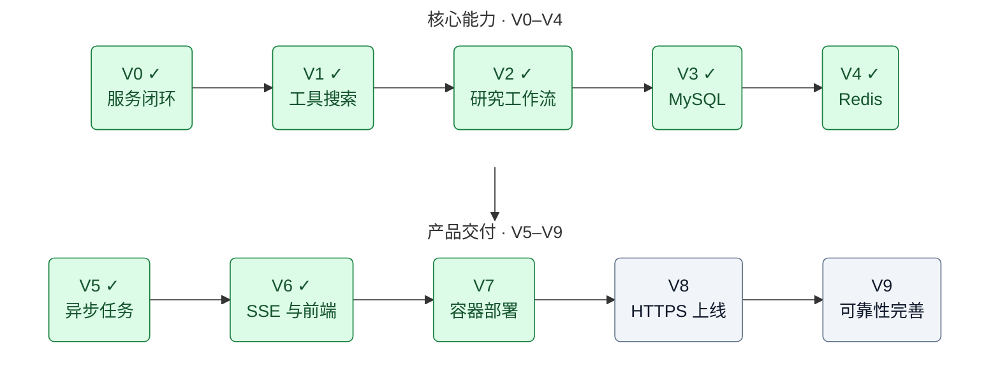

# AI Research Platform · 知序

基于 Go / Gin、Python / OpenAI Agents SDK 的研究助手。网页支持快速问答、深入研究、注册登录、个人历史，以及报告、搜索计划和来源展示。可以匿名体验；登录后提交的任务和报告自动保存到 MySQL。

前端使用 HTML / CSS / JavaScript，由 Go 同源提供，运行网站不需要 Node.js。Redis 用于搜索结果和任务状态缓存；独立的 Redis Streams 队列与 Go Worker 负责后台执行。

| 模块               | 职责                                         | 使用与实现说明                         |
| ------------------ | -------------------------------------------- | -------------------------------------- |
| `backend/`       | HTTP API、账号认证、任务与报告存储、静态页面 | [后端 README](backend/README.md)        |
| `agent-service/` | 问答、研究规划、联网搜索、报告生成           | [Agent README](agent-service/README.md) |
| `frontend/`      | 问题提交、账号与历史、报告阅读与下载         | [前端 README](frontend/README.md)       |
| `deploy/`        | 镜像构建、Compose、反向代理、部署与备份      | [部署 README](deploy/README.md)         |

## 当前功能与边界

| 能力                  | 当前实现                                                                      |
| --------------------- | ----------------------------------------------------------------------------- |
| 快速问答 `chat`     | Research Assistant 按需调用本地笔记或联网搜索工具，返回回答                   |
| 深入研究 `research` | Planner → 并行 Search Agent → Writer，返回带来源的 Markdown、计划和搜索资料 |
| 账号与历史            | 邮箱密码注册、JWT 登录、个人任务列表、状态、阶段记录、报告恢复                |
| 后台任务              | 登录提交立即返回任务编号；有界并发、幂等、重试、取消和 Worker 中断恢复        |
| 缓存                  | 搜索片段默认缓存 15 分钟；任务状态短时缓存；支持 `fresh=true` 绕过搜索缓存  |
| 网页交互              | SSE 阶段进度、断线重连、刷新恢复、Markdown、来源和历史分页             |
| 部署                  | Docker Compose；可在本机构建 Linux 镜像，上传服务器后直接运行                 |

两种模式的区别包括工作流和输出要求，并非只增加等待时间。普通问答不强制执行完整研究；深入研究会检查来源编号、正文和引用，并在资料不足时返回失败或注明缺口。报告基于搜索片段，尚未读取网页全文或自动验证每个结论是否被来源支持。

登录并启用 V5 后，网页通过 `POST /api/tasks` 提交后台任务，离开页面后仍会执行，可在历史中查询或取消。匿名体验和旧 `POST /api/research` 保留同步行为。V6 使用 SSE 展示真实阶段和已结束搜索数，支持断线补发与刷新恢复。尚未实现阶段断点续跑；Worker 中断恢复会重新执行整项任务，可能重复产生上游用量。所有访客共享服务端 Key，进程限流不等于个人费用上限。

## Docker Compose 启动（V7）

只需要 Docker Engine / Docker Desktop 与 Compose，无需在宿主机安装 Go、Python 或 Node.js。以下从项目根目录执行，首次复制配置后填入数据库密码、JWT 密钥、模型和搜索配置；已有文件会保留：

```bash
test -f deploy/.env || cp deploy/.env.example deploy/.env
test -f agent-service/.env || cp agent-service/.env.example agent-service/.env
chmod 600 deploy/.env agent-service/.env
```

编辑上述配置后，构建并启动：

```bash
bash deploy/compose.sh config --quiet
bash deploy/compose.sh build backend agent-service
bash deploy/compose.sh pull mysql redis redis-queue
bash deploy/compose.sh up -d --no-build --pull never --wait --wait-timeout 240
bash deploy/compose.sh ps
curl http://127.0.0.1:18080/health
```

访问 **http://127.0.0.1:18080**。四个镜像运行六个容器：API、Worker、Python、MySQL、缓存 Redis、队列 Redis。API 与 Worker 共用含静态网页的 Go 镜像，前端没有独立进程。默认 `linux/amd64` 与 x86_64 服务器一致；`APP_PORT`、`APP_PLATFORM` 和镜像名称可在 `deploy/.env` 修改，变更架构后需重新构建。

`bash deploy/compose.sh down` 停止并移除容器，保留命名数据卷。自动迁移、健康检查、启动重试、备份与恢复、离线镜像传输见[部署说明](deploy/README.md)。已经构建好镜像时，可用 `python3 deploy/smoke.py` 运行独立的完整容器验收：自动生成测试凭据、模拟模型与搜索、验证重建保留数据，结束后仅清理本次测试项目。测试记录在被 Git 忽略的 `test-results/v7-compose.json`。

## 本地启动完整功能

以下适合逐行调试代码；统一容器运行可使用上面的 V7 方式。

需要 Go 1.26.4+、Python 3.12+、uv，以及能运行 MySQL / Redis 的 Docker。模型服务需支持代码中使用的 `deepseek-flash`，联网研究还需要 Tavily Key。依赖版本与校验信息见 `go.mod` / `go.sum`、`uv.lock` 和前端测试的 `package-lock.json`。

以下每组命令都从项目根目录开始。已有 `.env` 时直接编辑，复制命令会保留现有文件。

### 1. 启动开发数据库与缓存

```bash
docker compose -f deploy/compose.dev-data.yaml up -d --wait
```

MySQL 使用本机 `13306` 端口，缓存 Redis 使用 `16379`，队列 Redis 使用 `16380`；数据库配置与 `backend/.env.example` 一致。它们只绑定本机回环地址，固定的开发密码只用于本地。数据库保存在该 Compose 项目的 `mysql_data` 卷中。

### 2. 启动 Python

```bash
cd agent-service
test -f .env || cp .env.example .env
uv sync --locked
```

编辑 `.env`，填写 `OPENAI_API_KEY`、`OPENAI_BASE_URL`、`TAVILY_API_KEY`，并取消 `REDIS_URL=redis://127.0.0.1:16379/0` 前的注释以启用开发缓存。然后启动：

```bash
uv run uvicorn main:app --reload --host 127.0.0.1 --port 8000
```

Python 自动加载本目录 `.env`，已有进程环境变量优先。模型配置、演示命令和缓存规则见 [Agent 说明](agent-service/README.md)。

### 3. 启动 Go

另开终端，从项目根目录执行：

```bash
cd backend
test -f .env || cp .env.example .env
```

首次配置时运行 `openssl rand -hex 32`，把结果填入 `.env` 的 `JWT_SECRET`。保留它供后续启动使用；更换密钥会使旧登录令牌失效。Go 不会自动加载 `.env`，启动时执行：

```bash
set -a
. ./.env
set +a
go run .
```

启动会自动执行 MySQL 迁移。需要编译整个目录，因此使用 `go run .`。

### 4. 启动独立 Worker

已有的 `backend/.env` 需要补入 V5 配置（首次复制新版示例时已经包含）：

```dotenv
QUEUE_REDIS_URL=redis://127.0.0.1:16380/0
QUEUE_PREFIX=arp
WORKER_CONCURRENCY=2
MAX_ACTIVE_TASKS_PER_USER=3
```

修改后重新加载环境并重启 Go API。另开终端，从项目根目录启动 Worker：

```bash
cd backend
set -a
. ./.env
set +a
go run ./cmd/worker
```

API 与 Worker 必须使用同一个 MySQL、`QUEUE_REDIS_URL` 和 `QUEUE_PREFIX`。Worker 日志出现 `[worker] starting concurrency=2` 表示消费循环已启动；API 的健康检查不证明 Worker 在线。队列故障时任务先保存在 MySQL，恢复后补投。

### 5. 打开网页与检查状态

访问 **http://127.0.0.1:8080**，右上角「登录 / 注册」可以创建网站账号；登录后提交研究，再从「我的历史」打开报告。网站账号由你自行注册，数据库密码和 `JWT_SECRET` 不用于网页登录。

```bash
curl http://127.0.0.1:8000/health
curl http://127.0.0.1:8080/health
```

完整配置下，Python 返回 `status=ok`、`redis=ok`，Go 返回 `status=ok`、`mysql=ok`、`redis=ok`、`queue=ok`、`async_tasks=true`、`task_events=true`。`disabled` 表示对应配置未启用；`unavailable` 表示连接异常。健康检查不调用模型，实际问答和研究成功才验证模型与搜索配置有效。

仅体验匿名问答时，可以跳过 MySQL / Redis，Go 启动前清除 `MYSQL_DSN`、`REDIS_URL` 和 `QUEUE_REDIS_URL`；此时账号和历史接口不会启用。网页需要 Go 的同源 API，不要直接双击 HTML 文件。

## API 示例

```bash
curl --max-time 140 http://127.0.0.1:8080/api/research \
  -H 'Content-Type: application/json' \
  -d '{"query":"解释 Go context 的取消传播机制","mode":"chat"}'

curl --max-time 320 http://127.0.0.1:8080/api/research \
  -H 'Content-Type: application/json' \
  -d '{"query":"根据官方资料研究 Go context 的取消传播机制","mode":"research","fresh":false}'
```

成功响应包含 `result`、`mode` 和阶段记录 `runs`；深入研究另外包含 `plan`、`search`。登录请求带 `Authorization: Bearer <token>`，保存成功后增加 `task_id`。问题去除首尾空白后为 1～5000 个字符，请求体最多 64 KiB。

Python 问答 / 研究总预算分别为 120 / 300 秒，Go 等待上限分别为 130 / 310 秒。以上是兼容的同步接口。登录后的后台任务改用：

```bash
curl -i http://127.0.0.1:8080/api/tasks \
  -H 'Content-Type: application/json' \
  -H 'Authorization: Bearer 替换为登录返回的token' \
  -H 'Idempotency-Key: replace-with-a-unique-key-001' \
  -d '{"query":"解释 Go context","mode":"research","fresh":false}'
```

预期立即返回 `202` 和 `task_id`，随后使用相同凭据访问 `GET /api/tasks/:id`、`GET /api/tasks/:id/report`、`GET /api/tasks/:id/attempts`；取消使用 `POST /api/tasks/:id/cancel`。同一用户、同一个幂等键和相同请求返回同一任务；新问题使用新键。默认最多 3 个活跃任务、每项最多 3 次执行，包含排队时间的总有效期为 30 分钟。

订阅自己的任务进度（替换任务编号和 token；`-N` 禁止 curl 输出缓冲）：

```bash
curl -N http://127.0.0.1:8080/api/tasks/替换为任务编号/events \
  -H 'Authorization: Bearer 替换为登录返回的token'
```

首次返回 `snapshot`，之后推送已落库的阶段与终态；重连可增加 `Last-Event-ID: 5`。单次连接最长 2 分钟或到 JWT 到期，网页自动重连。成功后读取 `/report`，进度事件不承载报告正文。

从 V5 升级：重启 Python、Go API、Worker 并刷新网页。Go 自动执行 `003_task_events.sql`，无需新增环境变量。升级前的任务支持状态快照，但不会补造此前没有记录的阶段事件。

完整接口、错误码、数据结构和缓存一致性见 [后端说明](backend/README.md#api)。

## 代码结构

```text
ai-research-platform/
├── backend/
│   ├── main.go             # 服务生命周期、依赖初始化与路由
│   ├── cmd/worker/main.go  # 独立 Worker 入口
│   ├── config.go           # 环境变量解析
│   ├── research.go         # 研究请求、调用 Python、结果落库
│   ├── limits.go           # 并发、频率和请求大小限制
│   ├── web.go              # 静态页面与安全响应头
│   ├── internal/
│   │   ├── handler/        # 注册登录、JWT 与个人任务接口
│   │   ├── model/          # 用户、任务、阶段和报告模型
│   │   ├── repository/     # MySQL 读写、事务与 migrations/
│   │   ├── queue/          # Redis Streams 投递、消费、接管与确认
│   │   ├── agent/          # Worker 的 Python HTTP 客户端
│   │   └── service/        # 任务状态缓存、Worker 执行与恢复
│   └── integration_test.go
├── agent-service/
│   ├── main.py             # FastAPI 入口、输入输出与模式分发
│   ├── research/           # Agent、工具、工作流、缓存与 demos/
│   ├── tests/              # 缓存与阶段记录测试
│   ├── .env.example        # 模型与搜索配置的唯一示例
│   ├── pyproject.toml
│   └── uv.lock
├── frontend/
│   ├── index.html
│   ├── assets/             # 页面交互、样式、SVG 与 vendor/
│   └── tests/              # Node / jsdom 行为测试
├── deploy/                 # Dockerfile、各环境 Compose、部署说明
├── compose.yaml            # Go + Python + 可选独立 Caddy 入口
├── .dockerignore
└── .gitignore
```

环境配置分别使用 `backend/.env.example`、`agent-service/.env.example`、`deploy/.env.example`。真实 `.env`、依赖目录、编译结果、数据库备份和镜像归档不提交 Git；`dist/` 仅存放本地生成的部署包，也不提交。

## 验证与部署

- [后端测试](backend/README.md#测试)：Go 接口、JWT、数据库事务、任务恢复与 Redis 缓存；完整测试使用独立的 `deploy/compose.test.yaml`。
- [Agent 测试与演示](agent-service/README.md#测试)：自动测试模拟模型与搜索；手动演示会调用真实服务。
- [前端测试](frontend/README.md#验证)：Node / jsdom 检查账号、报告、历史及会话行为；仅运行网站不需要 Node.js。
- [容器与服务器部署](deploy/README.md)：V7 本地完整启动、隔离验收、四个镜像的导出与上传，以及现有反向代理接入、日志、备份和旧镜像清理。

## 开发路线图：V0 → V9

进度更新日期：2026-10-21。路线沿用项目最初的 V0～V9 规划，V9 是本项目第一轮完整交付的终点。

图中的 `✓` 和下方清单的 `[x]` 表示已实现的目标，未勾选项为后续计划。



完整目标与验收方式见文末的[阶段目标与验收](#阶段目标与验收)。
图中的前后关系表示主线学习顺序：基础校验、超时和错误处理从 V0 开始，后续每一阶段继续完善。
V3 用户体系与 MySQL 持久化、V4 Redis 缓存、V5 后台任务、V6 SSE 与前端、V7 Docker Compose 本地部署已完成。网页支持实时阶段、断线补发、刷新恢复、取消、尝试记录和报告阅读，也保留匿名同步体验。V8 公网新版部署与 V9 可观测性等目标继续按清单推进。

启动、接口示例、任务缓存一致性和代码职责见 [后端说明](backend/README.md)；注册登录与历史记录的网页操作见 [前端说明](frontend/README.md)，服务器部署见 [部署说明](deploy/README.md)。

## 阶段目标与验收

以下列出各阶段的目标、任务与验收标准，具体进度通过任务清单和路线图展示。

### V0：最小服务闭环

**目标：** 用户提交问题，Go 调用 Python，Python 调用模型，最终返回答案。

- [X] 初始化独立项目、Go 模块和 Python 依赖环境。
- [X] Gin 提供 `GET /ping` 和 `POST /api/research`。
- [X] FastAPI 提供 `GET /health` 和 `POST /research`。
- [X] 使用 `Agent + Runner` 执行模型调用，返回 `{"result": "..."}`。
- [X] 校验输入，处理服务不可用、无效响应与请求超时。
- [X] 添加 README、Git 忽略规则，提交代码并推送到 GitHub。

**验收：** 从 Go 的 8080 端口提交问题可得到真实回答；空白问题返回 400；停止 Python 后 Go 返回 502 且自身保持运行。

**学习重点：** HTTP 服务与客户端、JSON 编解码、异步函数、环境变量、Git 基础。

### V1：工具调用与联网搜索

**目标：** Agent 能获取外部信息，使用实际返回的资料组织回答。

- [X] 用 `function_tool` 封装 `search_notes`，搜索本地项目笔记。
- [X] 接入 Tavily，提供 `search_web` 和可独立调用的 `fetch_web_results`。
- [X] 返回标题、URL 和内容片段；每次最多 3 条，每条最多 1500 个字符。
- [X] 在提示词中区分本地笔记搜索、联网搜索及引用规则。
- [X] 打印工具执行与来源日志，处理搜索超时、认证失败和网络异常。
- [X] 自动加载 `agent-service/.env`，配置模型与搜索服务的 Key。
- [X] 记录搜索片段的限制，提供单独搜索与完整接口测试命令。

**验收：** 本地笔记问题可引用笔记编号；联网问题触发真实搜索并返回来源链接；能从日志核对工具执行和来源。
本阶段不包含网页全文读取，也不代表已经自动验证引用与结论的一致性。

**学习重点：** 函数工具、模型与工具之间的数据传递、第三方 API、异步 HTTP、来源追溯。

### V2：Planner → 并行搜索 → Writer

**目标：** 对复杂研究问题先规划，再收集多组资料，最后生成有依据的报告。

#### V2.1：生成结构化搜索计划

- [X] 定义 `SearchItem` 与 `SearchPlan`。
- [X] Planner 输出研究目标、2～3 个搜索词及其目的。
- [X] 检查空内容、任务数量、完全重复的搜索词，并设置规划超时。
- [X] 提供 `python -m research.demos.planner_agent_demo` 独立验证入口。
- [X] 确认多个研究问题都能生成结构正确、搜索角度互补的计划。

Planner 已接入完整研究流程，也可在 `agent-service` 目录独立验证：

```bash
uv run python -m research.demos.planner_agent_demo "你的研究问题"
```

#### V2.2：并行搜索与资料汇总

- [X] 复用 `fetch_web_results`，按照计划执行每个搜索任务。
- [X] 新增 Search Agent，调用 Tavily 函数工具并生成摘要；Searcher 使用异步并发并限制同时运行数量。
- [X] 保留每次搜索的查询词、搜索目的、来源标题、URL 和片段。
- [X] 按 URL 去重；相同来源保留与不同搜索任务的关联。
- [X] 区分搜索成功、结果为空和执行失败；部分失败可继续，全失败明确返回失败。
- [X] 为 Writer 提供结构统一的资料集合与失败说明。
- [X] 保存实际工具结果、实际查询词与摘要；校验工具确实执行，并提供单个 Search Agent 验证入口。

```Shell
uv run python -m research.demos.search_plan_demo "研究问题"
```

#### V2.3：生成带引用的报告

- [X] 新增 Writer Agent，输入研究问题、计划、资料与搜索失败信息。
- [X] 输出包含结论、分析、适用条件、局限和来源的 Markdown 报告。
- [X] 资料不足时明确说明；不把搜索失败表述成“没有相关资料”。
- [X] 校验报告的来源编号，并使用实际资料中的 URL 生成链接；语义上是否支持结论仍需单独评估。
- [X] 控制输入资料长度与输出篇幅，避免无界增长。
- [X] 提供 `python -m research.demos.report_demo`，串联规划、搜索与写作。

运行方式与限制见[生成带引用的研究报告](agent-service/README.md#生成带引用的研究报告)。

#### V2.4：接入服务并验收

- [X] 用统一流程函数串联规划、搜索和写作，并接入 HTTP 研究入口。
- [X] 明确普通问答与完整研究的入口或模式，避免每个简单问题都执行全部步骤。
- [X] 重新分配各阶段超时，并协调 Python 总超时与 Go 客户端超时。
- [X] 记录各阶段开始、结束、耗时与失败原因。
- [X] 自动化测试验证完整成功、部分搜索失败、全部搜索失败和整体超时。
- [X] 通过 Go → Python 发起真实研究请求，返回计划、资料与带引用的报告。

**验收：** 一次完整研究请求能输出计划、执行多项搜索并生成有来源的报告；发生部分失败时报告说明资料缺口，全部失败时不编造报告。

**学习重点：** 结构化输出、工作流编排、异步并发、失败隔离、资料管理与引用校验。

### V3：MySQL 持久化与用户体系

**目标：** 研究记录可以长期保存，用户能查询自己的任务和报告。

- [X] 设计 `users`、`tasks`、`agent_runs`、`reports` 等表及关联关系；`messages` 在需要多轮会话时再引入。
- [X] 添加数据库配置、版本化迁移与连接检查。
- [X] 将 Go 代码逐步拆分为 handler、service、repository、model。
- [X] 保存研究问题、执行状态、开始与结束时间、阶段记录、报告及来源。
- [X] 提供任务列表、任务详情和报告查询接口，支持分页。
- [X] 增加注册、登录、密码哈希、JWT 校验和资源归属检查。
- [X] 为任务状态与报告保存设计事务边界，避免出现“成功但报告未保存”。

**验收：** 服务重启后历史仍可查询；用户只能读取自己的研究记录；失败任务也有可查询的状态与原因。

**学习重点：** 数据建模、SQL、事务、迁移、分层设计、认证和权限控制。

### V4：Redis 缓存与状态读取

**目标：** 减少重复搜索与高频数据库查询，为异步任务阶段准备基础设施。

- [X] 接入 Redis 客户端、连接配置与可用性检查。
- [X] 缓存适合复用的搜索结果，缓存键包含规范化查询词和影响结果的搜索参数。
- [X] 为缓存设置 TTL，明确时效性问题何时绕过缓存；不缓存执行失败作为正常结果。
- [X] 缓存高频读取的任务状态，明确 MySQL 是持久化状态的最终依据。
- [X] 设计更新或失效策略，防止缓存持续显示旧的任务状态。
- [X] Redis 不可用时，缓存功能可回退到数据库或原始搜索，并记录降级情况。

**验收：** 相同查询在缓存有效期内可复用结果；过期后重新获取；关闭 Redis 不导致历史记录丢失。

**学习重点：** 缓存键、TTL、缓存一致性、命中率与降级。任务队列在 V5 实现。

### V5：异步任务与 Worker

**目标：** 创建研究任务后立即返回任务 ID，后台持续执行，客户端按需查询结果。

- [X] 新增异步创建接口 `POST /api/tasks`；复用 V3 已有的 `GET /api/tasks/:id` 与任务归属校验。
- [X] 建立 `queued → running → succeeded / failed / cancelled` 状态流转。
- [X] 基于 Redis Streams 或成熟队列方案实现投递、消费和确认。
- [X] 处理数据库写入与入队之间的失败，例如通过 outbox 或定期补偿避免漏投任务。
- [X] 将 Worker 与 HTTP 请求生命周期分开，限制执行并发数。
- [X] 实现幂等处理、有限重试、任务超时、失败记录及 Worker 中断后的恢复。
- [X] 支持查询或取消任务，并明确排队中与执行中的取消行为。

**验收：** 创建任务快速返回 ID；关闭客户端不影响后台执行；重复投递不会重复保存报告；Worker 重启后任务可恢复或明确失败。

**学习重点：** 队列、消费者、状态机、幂等性、重试、任务恢复。Redis 此时承担队列职责，需配置持久化与恢复策略。

### V6：SSE 执行进度与最小前端

**目标：** 用户可以在网页提交研究、查看进度、阅读报告和历史记录。

- [X] 提供任务事件接口，`GET /api/tasks/:id/events`，检查访问权限。
- [X] 定义排队、规划完成、搜索进度、写作、成功、失败和取消等事件。
- [X] 将运行状态展示与最终报告区分，使用阶段和已完成任务数表达进度。
- [X] 实现 SSE 心跳、断线重连、事件序号和终态通知；重连后能恢复当前状态。
- [X] 在 JWT 认证方案下明确 SSE 的认证方式，避免把长期凭据放进 URL。
- [X] 完成注册登录、研究提交、个人任务列表、任务详情、报告与来源链接等页面（登录异步提交，匿名同步请求；活跃任务详情用 SSE，列表仍定期刷新）。
- [X] 安全渲染 Markdown，提供加载、空结果、失败和重试提示。

**验收：** 从浏览器完成登录、创建研究、观察进度和阅读报告；刷新或断网重连后能恢复状态；不能订阅其他用户的任务。

**学习重点：** SSE、事件设计、前后端联调、连接生命周期和状态恢复。

### V7：Docker Compose 本地部署

**目标：** 在具备容器环境的机器上，按照文档统一启动整个项目。

- [X] 构建 Go / Python 镜像；API 与 Worker 分容器运行，静态前端随 Go 镜像交付。
- [X] Compose 管理应用、MySQL、Redis、内部网络和持久化卷。
- [X] 将服务地址、监听地址和端口改为配置项；容器间通过服务名访问。
- [X] 配置健康检查、启动依赖、MySQL 有界启动重试及 Worker 队列重连。
- [X] 提供不含真实密钥的配置模板，避免将 `.env` 和凭据打入镜像。
- [X] 写明数据库迁移、启动、停止、日志查看和数据备份步骤。

**验收：** 新环境按 README 配置后可启动完整系统；应用容器重建后，数据库和报告仍然保留。

**验证方式：** `python3 deploy/smoke.py` 对真实 amd64 应用镜像、MySQL 和 Redis 运行注册、问答、后台研究、SSE、备份恢复、故障恢复与全容器重建验收。模型与搜索结果使用测试替身，不作为真实模型质量或 V8 公网部署的验证。

**学习重点：** 镜像、容器网络、服务发现、数据卷和多服务配置。

### V8：Nginx、HTTPS 与服务器部署

**目标：** 通过自己的域名访问应用，完成一次真实部署。

- [X] 准备服务器、域名解析及应用配置。
- [X] 使用 Nginx 提供前端并反向代理 Go API。
- [X] 配置 HTTPS、证书续期和 HTTP 到 HTTPS 跳转。
- [ ] 为 SSE 配置适合的代理缓冲与连接超时策略。
- [ ] 限制 MySQL、Redis 和 Python 内部接口的公网访问。
- [ ] 建立部署、迁移、备份、恢复和回滚步骤。

**验收：** 域名 HTTPS 可访问；登录、创建任务、进度与报告均可用；重启服务不丢失历史；SSE 不被代理长时间缓冲。

**学习重点：** 反向代理、TLS、域名、网络边界和部署运维。

### V9：可靠性与可观测性完善

**目标：** 让系统具备可解释、可维护、可演示的工程质量。

- [ ] 对用户请求、搜索调用和 Worker 执行设置限流、并发上限与资源预算。
- [ ] 统一各层超时，区分可重试和不可重试错误，采用有限次数的退避重试。
- [ ] 使用 request ID、task ID 串联 Go、Python、队列和阶段日志，避免记录密钥。
- [ ] 记录成功率、延迟、队列积压、缓存命中和可获得的模型或搜索用量指标。
- [ ] 按需接入 tracing；第三方模型与追踪服务分别配置认证，追踪异常不能影响业务。
- [ ] 完成关键接口与流程测试，覆盖鉴权、幂等、超时、部分失败和恢复。
- [ ] 建立固定研究问题集，评估资料相关性、引用支持程度和报告质量。
- [ ] 做适量并发测试和故障演练，检查恢复、取消及备份可用性。
- [ ] 完成架构说明、配置模板、接口示例、部署手册和演示流程。

**验收：** 关键流程测试通过；第三方服务异常时任务有明确结果；能凭 task ID 定位失败阶段；具备可重复的部署与恢复步骤。

**学习重点：** 限流、可观测性、故障恢复、性能验证和 Agent 质量评估。

## 首轮交付完成标准

- [ ] 用户能在 HTTPS 网页中登录、提交研究并获得任务 ID。
- [ ] 后台能完成规划、资料搜索和带来源的报告写作。
- [ ] 页面能显示执行进度，并查询历史任务与报告。
- [ ] 用户之间的数据隔离有效，配置和密钥不进入公开代码或日志。
- [ ] 服务重启、搜索失败或模型超时都有明确处理，任务不会无期限停留在执行中。
- [ ] 新环境能按文档启动项目，部署、备份和恢复流程可重复执行。

网页全文读取与更严格的来源语义核验属于后续增强项，可在 V2 主流程稳定后单独推进；当前报告必须持续说明仅使用搜索片段的限制。
